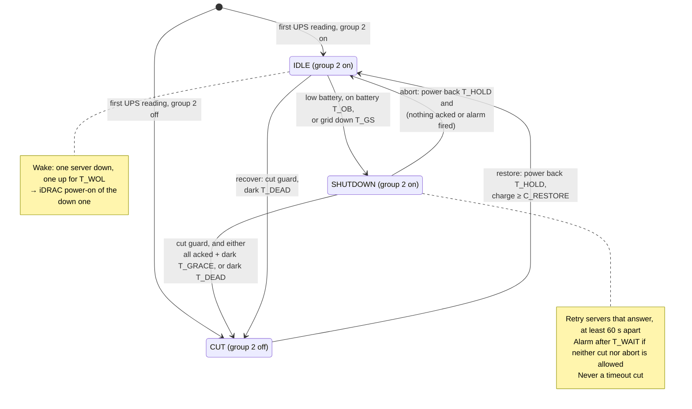

# ups-sync controller: state machine and formal verification

This document is the authoritative description of the outage controller. The
TLA+ models in `formal/` are the executable version of it; if they disagree,
the models win and this document is wrong.

## 1. Actors

| Actor | Where it runs | What it can observe | What it can do |
| --- | --- | --- | --- |
| **Controller** (`custom_components/ups_sync`) | Home Assistant Yellow, outlet group 1 | APC output status, runtime, output watts, low-battery threshold and group 2 state, all read from the card over SNMP; a TCP probe of each server (ping is not used: sakuya drops ICMP); iDRAC chassis power state per server; success/failure of each shutdown command | OS shutdown per server (Proxmox API for sakuya, iDRAC graceful shutdown for both); iDRAC power-on per server; SNMP immediate-off / immediate-on on group 2; notifications |
| **Server backstop** (NUT client on flandre and sakuya) | each server | APC status via its own `snmp-ups` driver pointed at the NMC (not via HA) | shut itself down |
| **NMC load shed** (APC card firmware) | the UPS | on-battery time, runtime remaining | turn group 2 off; turn it back on after min return runtime |
| **BIOS** | each server | AC present on its PSU | power on when AC returns |
| **Environment** | — | — | grid up/down at any time; transfer switch GRID/DPU at any time; DPU at any state of charge; HA crash/reboot at any time; server shutdown 2–8 min, boot 2–6 min; ping dying up to 2 min before power-off; human power-off/power-on while input is present |

The controller never reads the Delta Pro Ultra itself. Its Bluetooth link
goes through a proxy that is on grid power, so DPU data is unavailable
exactly when it would matter. To the APC the DPU is an upstream buffer whose
only visible effect is *when* the APC loses input.

What the controller can use instead is an optional **grid sensor**: one or
more Home Assistant entities that only work while the grid is up, such as
the wall charger's voltage. It gives two separate answers. There is
evidence the grid is **up** if any one of them is available, not "off" and
not zero. There is evidence it is **down** if every entity that an
integration is actually providing shows no life, even though the APC still
has input, which means the DPU is carrying it. An entity that no
integration is providing says nothing either way. Starting a shutdown needs
evidence of down; restoring or waking needs evidence of up; a silent sensor
allows neither. The sensor can be wrong in either direction (a device offline for its
own reasons, or a stale reading), so it is only allowed to cause a clean
shutdown and to hold back a restore. It can never cause or permit a cut by
itself, and the models are checked with a sensor that lies at will.

## 2. Controller states

`sensor.ups_sync_state` reports which state the controller is in. Reading
the diagram:

- **Power back** means UPS input present and, if a grid sensor is
  configured, the sensor confirming the grid is up.
- **Cut guard**: group 2 on, no server answers, no iDRAC reports power on,
  and the UPS load at or below the configured idle-load limit.
- **Grid down** starts a shutdown only outside maintenance, and only once
  the idle-load limit is set and a peak load is known (section 8). The
  on-battery and low-battery triggers have no such conditions.
- **Recover** also needs a known peak load, and this process must have
  watched the darkness itself for `T_GRACE`.
- **Wake** also needs power back, reserve ≥ `E_RESTORE`, and the down
  server's iDRAC reporting it off.
- **Maintenance** blocks the grid-down trigger, recover, wake and restore.
- **Cut and restore** are commands to the card. The state becomes CUT when
  the card acknowledges the cut or the group is seen off. After a restore it
  becomes IDLE only when the group is seen on.
- **Not drawn**: the reconciliation rule below, which moves IDLE or SHUTDOWN
  to CUT whenever group 2 is seen off, and CUT to IDLE whenever it is seen on.
- **Disarmed**, the state is held at IDLE or CUT to match group 2, and
  `would_act` shows what the controller would do from there; nothing is
  sent.
- Names are the model's. The defaults, all configurable: `T_OB` 2 min,
  `T_GS` 5 min, `T_GRACE` 2 min, `T_DEAD` and `T_WOL` 10 min, `T_HOLD`
  6 min, `T_WAIT` 24 min, `E_RESTORE` 26 min of runtime at the peak load,
  `C_RESTORE` 80 % battery charge (section 7).

**Reconciliation rule.** The controller state is anchored to the observable
group 2 state. Group 2 off while in IDLE or SHUTDOWN forces CUT. Group 2 on
while in CUT forces IDLE. On every HA start the state is derived this way;
no persisted flag is trusted. This is what makes HA crashes and the card's
own actions (load shed, auto-return) harmless.

### IDLE (group 2 on)

- Each tick: `obT` = consecutive ticks with APC on battery, else 0.
- **→ SHUTDOWN** when `obT ≥ T_OB` or NUT reports LB.
- **→ CUT (recover)** when group 2 is powered, no server answers ping, UPS
  load is at the "servers off" baseline, and this has held for `T_DEAD`.
  Input presence is deliberately **not** required: dead outlets should go
  dark whether or not the grid is back. This power-cycles servers that were
  shut down (by the backstop, by a crashed HA mid-sequence, by hand) but
  never had their power cut, so BIOS can bring them back on restore, and it
  removes live-but-unused outlets that a human could power a server from
  while the UPS is low. The load guard means a server that is merely
  booting or has its network down is never power-cycled. The `T_DEAD` timer
  is a persisted "last time any server answered" timestamp, so it survives
  HA restarts.
- **Wake (iDRAC power-on)** when some server is unreachable while another is
  up, group 2 is powered, input is present, reserve ≥ `E_RESTORE`, and this
  has held for `T_WOL`. This covers the leftover of an interrupted shutdown
  (HA crashed after powering off one server). Cycling the group would
  hard-cut the running server, so the down one is powered on individually
  through its iDRAC (Redfish `Reset` with `On`). Both servers have iDRAC, so
  Wake-on-LAN is not used. The iDRAC must report chassis power **off**
  before the command is sent; a server that is merely booting is left alone.
  In the TLA+ models this action is still named `DoWol`; the model only
  cares that it powers on exactly the unreachable server.

- **→ SHUTDOWN (grid loss)** when a grid sensor is configured and has read
  "down" for `T_GS`, even though the APC is online. This saves the DPU for
  the loads that must stay up. From here the sequence is the ordinary one:
  commands, cut behind the same guard, CUT. Maintenance turns this trigger
  off, for when the servers should keep running on the DPU; the on-battery
  triggers are unaffected.
- No wake unless the grid sensor (if configured) gives evidence of up.

### SHUTDOWN (group 2 on)

- Every 60 s: a shutdown command to every server that still answers; record
  per server whether a channel accepted it (`acked`). Channels are tried in
  order: the Proxmox API where a token is configured, then iDRAC graceful
  shutdown (ACPI power button). Home Assistant holds no shell keys.
- `darkT` = consecutive ticks with group 2 powered and no server pingable.
- **→ CUT** when no server pings, UPS load is at baseline, no iDRAC reports
  chassis power on, and either every server acked and `darkT ≥ T_GRACE`, or
  `darkT ≥ T_DEAD` (servers went away without our command, e.g. backstop or
  manual shutdown). The iDRAC check is an extra guard on top of the load
  guard, not a replacement: it can only delay a cut, never permit one, so
  it cannot weaken `NoHardCut`. If an iDRAC is unreachable it is treated as
  "unknown" and the load guard alone decides, as in the model.
- **Alarm** when `waitT ≥ T_WAIT`: notify loudly, keep waiting. There is
  deliberately no timeout cut. Every cut goes through the load guard; a cut
  that ignores it is a hard cut by construction. The model proves the alarm
  never fires unless a human keeps powering servers back on mid-sequence.
- Input returning during SHUTDOWN does **not** abort a shutdown that a
  server has accepted. A half-finished shutdown is worse than a finished
  one followed by a restore. The one exception is in section 8: if no
  server accepted a command, or the alarm has already fired, and input has
  been stable for `T_HOLD`, the controller returns to IDLE.

### CUT (group 2 off by us)

- `holdT` = consecutive ticks with APC input present and, if a grid sensor
  is configured, the grid sensor giving evidence that the grid is up. Input that comes from the DPU
  is not "power is back".
- **→ IDLE (restore)** when `holdT ≥ T_HOLD` and the battery charge is at
  least `C_RESTORE` % (in the model, `e ≥ C_RESTORE % of EMAX`; see
  section 8): SNMP immediate-on on group 2. Servers boot via BIOS.

## 3. Backstops (work with HA dead)

1. **Server NUT clients** monitor the NMC directly over SNMP. Shut down on
   LB, or after `T_SRV_OB` on battery.
2. **NMC load shed** on group 2: "UPS runtime remaining < E_SHED". Never
   "power failure longer than N seconds". After a shed the group is set to
   stay off; the controller restores it.
3. **NMC min return runtime** on group 2, set to the card's maximum, keeps
   servers off after a full UPS death until the reserve is back above
   `E_RETURN`.
4. **BIOS restore on AC** on both servers.

## 4. Properties checked

| Property | Kind | Meaning |
| --- | --- | --- |
| `NoHardCut` | safety | no server ever loses power while RUN, SHUT or BOOT |
| `NoTimeout` | safety | the `T_WAIT` alarm never fires (checked without human interference) |
| `NoSpurious` | safety | SHUTDOWN is entered only on battery, on LB, or when the grid sensor reads down |
| `TypeOK` | safety | all counters stay in range |
| `EventuallyRunning` | liveness | if grid and HA eventually stay up, the grid sensor (if any) eventually keeps reading up, and, in the two-server model, humans stop acting, then every server not deliberately powered off by a human is eventually running and stays running |

## 5. Verification results

See `formal/RESULTS.md` (generated from the TLC runs) for the parameter
table, pass/fail per variant, and counterexample traces.

## 6. Assumptions the proof depends on

- Shutdown completes within `SMAX` and boot within `BMAX` once started.
- The UPS runtime estimate is roughly honest (we take 57 min at today's
  load and use it as the full-charge budget).
- Nobody presses power buttons or runs `poweroff` by hand while the UPS is on
  battery, and nobody powers a server **on** while the UPS has less than
  `E_RESTORE` of reserve (about 60 % charge). The model found that a human powering a
  server on from a live outlet with ~11 min of runtime left, during a
  flapping grid, ends in a hard cut that no controller can prevent. Let HA
  bring the servers back; it waits for the runtime margin.
- SNMP and NUT reads from HA succeed within a tick (2 min). The network
  (group 1) stays up as long as the UPS has output.
- UPS load is a faithful "something is drawing power on group 2" signal.
  Calibrate: baseline = group 1 load with both servers soft-off but still
  plugged in, so the iDRACs' standby draw (roughly 10-20 W each) is part of
  the baseline. Guard threshold = baseline + 40 W.
- A manual power-off for maintenance must be preceded by switching the
  `ups_sync_maintenance` boolean on, which disables the recover and wake
  rules; otherwise HA will wake or power-cycle the box within 10 minutes.
- Both iDRACs are reachable from the HA host over the group-1-powered
  network whenever their outlet has power (dedicated iDRAC NIC or shared
  LOM; both work with the host off). iDRAC credentials live in HA
  the integration's config entry, like any other Home Assistant
  integration's.
- The APC's own "min return runtime" and "load shed" settings are set as
  specified in the config table and not changed by hand.

## 7. Mapping model units to production

| Model | Production |
| --- | --- |
| 1 tick | 2 min |
| `e` = 1 | 1 min of full-load runtime (57 at full charge); drains 2/tick with servers on, 1/tick with only group 1 |
| `T_OB` = 1 | shutdown starts 2 min after going on battery |
| `T_GS` = 1 | shutdown starts after the grid sensor has read down for 5 min (`t_grid`, 300 s; the model uses one tick) |
| `T_GRACE` = 1 | wait 2 min after the last ping before cutting |
| `T_DEAD` = 5 | 10 min dark (persisted) before cutting a group whose servers are all off |
| `T_WOL` = 5 | 10 min with one server down and one up before iDRAC power-on of the down one |
| `T_HOLD` = 3 | 6 min stable input before restore |
| `E_RESTORE` = 26 | wake a server only with a reserve of ≥ 26 min *at the heaviest running load seen* (a little over half charge today); also the bound on humans powering servers on |
| `C_RESTORE` = 80 | restore a cut group only at ≥ 80 % battery charge, `e ≥ 0.8 x EMAX`. A smaller `EMAX` models an aged battery; the restore is safe while `C_RESTORE x EMAX / 100 ≥ E_SHED + DRAIN_HI x (BMAX + SMAX + T_OB)` = 19 |
| `E_LB` = 16 | UPS low-battery threshold 16 min (NMC "Low battery duration") |
| `E_SHED` = 3 | NMC load shed group 2 when runtime < 3 min. Was 6; lowered so the card's own return threshold is enough (see RESULTS.md) |
| `E_RETURN` = 17 | NMC min return runtime 60 min, the card's maximum. The card measures at the present load, so with the servers off this is only about 17 to 23 min with them running |
| `T_SRV_OB` = 5 | server NUT client shuts down after 10 min on battery |

## 8. Where the code differs from the model

The code is `custom_components/ups_sync/machine.py`. Its rules carry the
model's operator names in comments. The differences below are deliberate.
Each one either only removes or delays actions, or is equivalent to a step
the model already allows.

| Difference | Why it is safe |
| --- | --- |
| **Battery reserve is not the UPS's raw runtime figure.** The UPS reports runtime at its *present* load. With the servers off that is two to three times what it will be once they run, so comparing it with `E_RESTORE` would wake a server far too early. The model's `e` is minutes with every server running. The code scales the UPS's figure to the peak load: `reserve = runtime x (load now / peak) ^ 1.4`. The peak is the heaviest load seen *while every server was up*. Readings with a server off or booting do not count: standby draw would understate it and a boot surge would overstate it for good. A server answers on the network before its boot is over, so readings only count once every server has been reachable without a break for five minutes. A failed or missed UPS reading restarts those five minutes, because a server may have rebooted unseen. The exponent is deliberately above the 1.2 to 1.36 that APC's runtime tables give for this UPS, so the result never overstates. The peak only rises, needs two consecutive readings to rise, and is stored. Until one exists, wake and the power-cycle of dead outlets are refused, and so is a restore on a card that does not report its charge. `E_RESTORE` = 26 leaves room for a boot that draws up to about twice the running load. | This is what makes the code match the model's `e`. Found in review: the first version compared raw runtime, the second learned a ratio that followed recent load, the third counted boot surges. |
| **A restore goes by battery charge, not by the scaled reserve.** With the group cut the UPS load is about 155 W, a third of the peak, and the scaling above halves the card's runtime from there: on 2026-11-20, at 94 % charge and never on battery, the reserve read 38 with the servers running and 20 to 22 with the group cut, under `E_RESTORE`, so a group cut by the grid trigger was never restored. The card's own figures that night put its curve between those loads near 0.7. Charge does not depend on the load. The restore needs `charge ≥ C_RESTORE`; the model's `ChargeOk` is `e x 100 ≥ C_RESTORE x EMAX`, with `EMAX` the energy of this battery when full, so an aged battery is a smaller `EMAX`. A card that does not report charge falls back to the reserve. Waking a server still uses the reserve, because the load is then near the peak, where the exponent holds. | Equivalent to the model's `DoRest`. The bound `C_RESTORE x EMAX / 100 ≥ 19` holds down to `EMAX` = 24, under half the 57 of a full battery today; checked in `formal/RESULTS.md` (Revision 2026-11-20). |
| Real seconds and 15 s polling instead of 2-minute ticks. A timer counts how long a condition has been *watched* without interruption. If two readings are more than 120 s apart (failed UPS reads, a stalled HA), every timer restarts. 120 s is also when the problem sensor reports the UPS as unreadable. | A refinement: "held for N ticks" becomes "held for N x 120 s", and unobserved time never counts. |
| The stored "all servers silent since" time survives restarts, as in the model. It may be stale, so a power-cycle also needs this process to have watched the silence itself for `T_GRACE`. A stored time in the future is discarded. | Only removes cuts. |
| The state becomes CUT when the card acknowledges the off command or the group is *observed* off, and returns to IDLE only when the group is observed on. | A failed SNMP write is retried on the next poll instead of being assumed. Ending the shutdown on the acknowledgement means that if the group comes back on while the UPS is unreadable, the servers are not shut down a second time on good power. Known residual: if the card carries out the off command but its acknowledgement is lost, and the UPS is then unreadable, and the group comes back on, that second shutdown can still happen. It is followed by the normal cut and restore and is never a hard cut. |
| The cut guard is evaluated again on fresh readings immediately before the SNMP write. | Only removes cuts. |
| The iDRAC check treats every state except a clear `Off` as on (`PoweringOn`, `PoweringOff`). A refused TCP connection counts as reachable, because a refusal comes from a running kernel. | Only removes cuts. |
| If the UPS cannot be read, or reports bypass, self-test or off, the step is skipped: no decision. The problem sensor turns on after 2 min. | Only removes actions. The server backstops do not depend on Home Assistant. |
| Abort: in SHUTDOWN, if input has been stable for `T_HOLD` and either no server accepted a command or the alarm has fired, return to IDLE. The model has no failing commands, so it never needs this. | Returning to IDLE is exactly what an HA restart does, and the model lets HA restart at any step. |
| Maintenance also blocks restore, not only recover and wake. Turning maintenance off restarts the recover and wake timers. | Only removes actions. |
| Disarmed (the default after install): readings and timers run, decisions are computed on a copy and published as `would_act`, nothing is sent. | No actions. |
| The load guard refuses every cut until the idle load is configured. | Only removes cuts. |
| The problem sensor also turns on when every server has been silent for `T_DEAD` but the guard refuses the power-cycle (for example the idle load setting is too low), when the group has been off with stable input for six hours without a restore, and when a cut or restore command fails. | Reporting only. Without it, servers could stay off with nothing to say so. |
| The grid sensor is a list of entities with three outcomes (up, down, silent) rather than the model's two. Its timers restart after a gap in readings like every other timer. | Silent has a subset of the effects of the model's "down": it holds back restore and wake but starts nothing. The model's sensor may read down at any time, so every silent behaviour is covered. |
| The grid-loss shutdown waits until the controller is calibrated: idle load set and peak load known. | Only removes a shutdown. Without the idle load no cut is allowed, and without the peak no wake or power-cycle is (nor a restore on a card that does not report charge), so a grid shutdown before either could leave the servers off. The on-battery triggers do not wait. |
| A grid entity that no integration is providing says nothing and raises the problem sensor: one Home Assistant does not know at all (renamed, deleted), or one it has only restored as a placeholder after a restart because the owning integration has not loaded. A silent sensor cannot start a shutdown and cannot allow a restore or a wake. The second half matters after a Home Assistant restart in the middle of an outage: the wall charger has no power, its integration cannot load, and the servers must not come back on the DPU. If the group has been off for six hours with UPS input present and no evidence of the grid in all that time, the problem sensor turns on. That six-hour timer is not stored and restarts with Home Assistant, after an unreadable stretch, and whenever the sensor reads up once; `waiting_for_grid` says why from the first minute regardless. Turning maintenance off restarts the grid timer. | Reporting, and removing shutdowns. A sensor that stops working must not keep the servers off unnoticed. |

`tests/test_sim.py` is a Python port of the model's environment that drives
this code through random outages. Unlike the model, its UPS reports runtime
at the present load along a curve the controller does not know, each
server's draw wanders, booting draws 75 % more than its running maximum
and a booting server answers on the network before its boot is over,
load readings are noisy, the UPS is sometimes unreadable, and the card may switch
the group back on by itself whenever its own threshold is met. It checks
`NoHardCut`, `NoSpurious`, the alarm, and recovery on every run.
